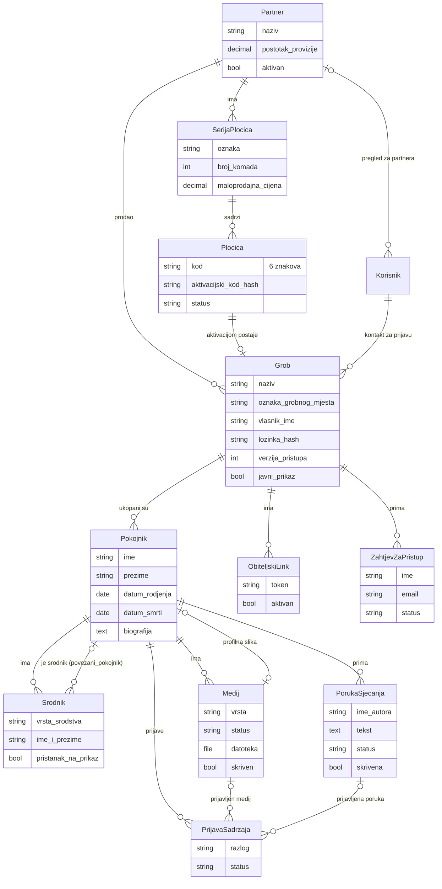

# Modeli podataka

Nazivi prate rječnik pojmova iz `docs/odluke.md`. GitHub ovaj dijagram sam iscrtava.

Model `NeuspjeliPokusaj` (aplikacija `pristup`) nije vezan stranim ključem: bilježi
vrstu (lozinka ili aktivacija), cilj (ID groba ili kod pločice) i IP adresu, za
zaključavanje nakon više pogrešnih pokušaja (P-13). Granice su u postavci
`OGRANICENJA_POKUSAJA`: za lozinku groba 5 pogrešnih s iste IP adrese u 15 minuta
ili 30 s bilo koje adrese u sat vremena. Blokada traje isto toliko, računajući od zadnjeg pogrešnog pokušaja, i dok traje,
lozinka se uopće ne provjerava. Zapise starije od 24 sata briše naredba `ocisti_pokusaje`.

Ista evidencija broji i poslane linkove za prijavu (vrsta `prijava`, najviše 3 za isti
e-mail u 15 minuta). Kao cilj se sprema otisak adrese s ključem (HMAC), a ne sama adresa. S jedne IP adrese
prolazi najviše 10 zahtjeva u 15 minuta.

## Ključne odluke

- **Jedan QR po grobu** (odluka 4). `Plocica` i `Grob` su vezani jedan-na-jedan, a u grobu može biti više pokojnika. Pločica postoji prije groba: izrađuje se u seriji, a grob nastaje tek kad je obitelj aktivira.
- **Vlasnik i kontakt za prijavu su odvojeni** (odluka 19). `vlasnik_ime` je osoba iz evidencije uprave groblja, a `kontakt_za_prijavu` je korisnički račun koji se prijavljuje e-mailom. To ne mora biti ista osoba, npr. kad vlasnik nema e-mail pa grobom upravlja unuka.
- **Partner je i na seriji i na grobu** (odluka 15). Serija određuje kojem je partneru pločica dodijeljena. Pri aktivaciji se partner kopira na grob, pa obračun ostaje točan čak i kad se serija kasnije ispravlja.
- **Tajne su samo hashirane.** Aktivacijski kod i lozinka groba spremaju se preko Djangovog `make_password`, a čitljiv aktivacijski kod postoji samo u ZIP-u koji se preuzme pri stvaranju serije. Token obiteljskog linka ima 32 bajta slučajnosti i ne prikazuje se u adminu.
- **Živući srodnici imaju samo ime** (odluka 3a, GDPR). Ograničenje u bazi traži da srodnik ima **ili** povezanog pokojnika **ili** ime živuće osobe. Za živuće osobe nema polja za datum rođenja, kontakt ni sliku.
- **Brisanje je zaštićeno.** Partner sa serijom i serija s pločicama ne mogu se obrisati (`PROTECT`). Grob u adminu briše samo superuser (OP-7).

## Pristup grobu (P-12)

Sadržaj groba vidi tko ispuni barem jedno:

- grob ima uključen `javni_prikaz`;
- prijavljen je kao kontakt za prijavu tog groba ili kao superuser;
- preglednik ima valjan **kolačić pristupa** `vs_g<id groba>`.

Kolačić nastaje nakon točne lozinke (kasnije i nakon ulaska obiteljskim linkom). Potpisan
je (`SECRET_KEY`), `HttpOnly`, `SameSite=Lax`, u produkciji i `Secure`, a traje 12 mjeseci.
Vrijednost je `<id groba>:<verzija_pristupa>:<id obiteljskog linka ili ->`, bez lozinke.
Povećanje `Grob.verzija_pristupa` zato odjavljuje sve zapamćene uređaje, a poništavanje
obiteljskog linka odjavljuje one koji su ušli preko njega. Logika je u `pristup/kolacici.py`.

Lozinka groba ima najmanje 6 znakova (`jezgra/lozinke.py`), što provjerava i sam
`Grob.postavi_lozinku()`.

## Aktivacija (P-18 do P-20)

Čarobnjak: aktivacijski kod → podaci groba i lozinka → prvi pokojnik → slike.

- Aktivacijski kod se prije provjere normalizira (velika slova, bez razmaka i crtica).
  Pogrešan kod, kod druge pločice, već aktivirana i nepostojeća pločica daju istu poruku.
- Ograničenje: 5 pogrešnih s iste IP adrese na sat i 10 po pločici na dan.
- Grob nastaje u jednoj transakciji uz `select_for_update` nad pločicom
  (`aktivacija/servis.py`), pa dva istovremena zahtjeva stvaraju samo jedan grob.
  Partner se kopira iz serije.
- Ako e-mail kontakta za prijavu još nema račun, račun se stvara (bez lozinke) i osoba
  je odmah prijavljena (OP-5). **Ako račun već postoji, grob mu se dodaje, ali se osoba
  ne prijavljuje**: inače bi svatko s aktivacijskim kodom upisom tuđe adrese ušao u tuđi
  račun. Čarobnjak se tada dovršava preko oznake u sesiji (60 minuta), a vlasnik računa
  dobiva e-mail.

## Prijava vlasnika (P-17)

Vlasnički dio nema lozinku. Kontakt za prijavu upiše e-mail i dobije link
(`django-sesame`) koji vrijedi 15 minuta i samo jednom. Otvaranje linka prikazuje
gumb „Prijavi me”, a prijavljuje tek klik na njega. Odgovor je isti postojala
adresa u sustavu ili ne. Prijava traje 30 dana. Administratori (`is_staff`) link ne
dobivaju: oni se prijavljuju lozinkom u `/admin/`.

## QR kodovi (P-10)

Link je VELIKIM slovima, s korekcijom pogrešaka H, pa QR koristi alfanumerički način:

| Adresa | QR verzija | Veličina |
|---|---|---|
| `HTTPS://VJECNASPOMEN.HR/G/K7M4QX` | **3** | 29 × 29 modula (odluka 18 ✔) |
| `HTTPS://VJECNASPOMEN.ONRENDER.COM/G/K7M4QX` (demo) | 4 | 33 × 33 modula |
| `HTTP://192.168.1.85:8000/G/K7M4QX` (lokalno) | 3 | 29 × 29 modula |

Slike imaju bijeli rub od 4 modula (`border=4`), koji je obavezan za pouzdano čitanje.
PNG je u mjerilu 10 px po modulu (29 modula + rub = 370 × 370 px), a SVG je vektorski.

### Kako se stvara serija

Admin → *Serije pločica* → **Dodaj**. Upišeš partnera, oznaku (npr. `DEMO-01`), broj komada i cijenu.
Odmah se preuzima `serija-<oznaka>.zip` koji sadrži:

- `kodovi.csv` sa stupcima `kod`, `aktivacijski_kod`, `link`. **Ovo je jedina kopija aktivacijskih kodova.**
- `KOD.svg` i `KOD.png` za svaku pločicu.

QR slike postojećih pločica, bez aktivacijskih kodova, preuzimaju se akcijom
*Preuzmi QR slike* u popisu pločica ili serija.
